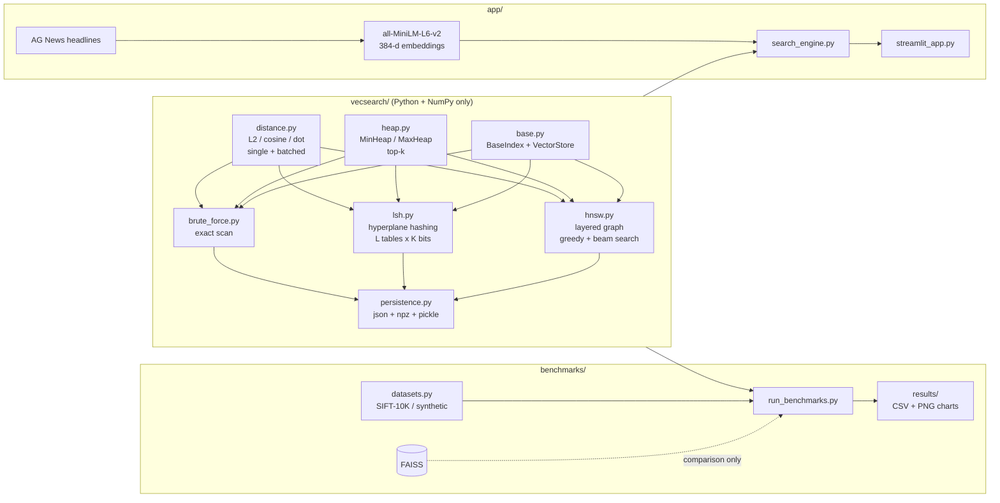
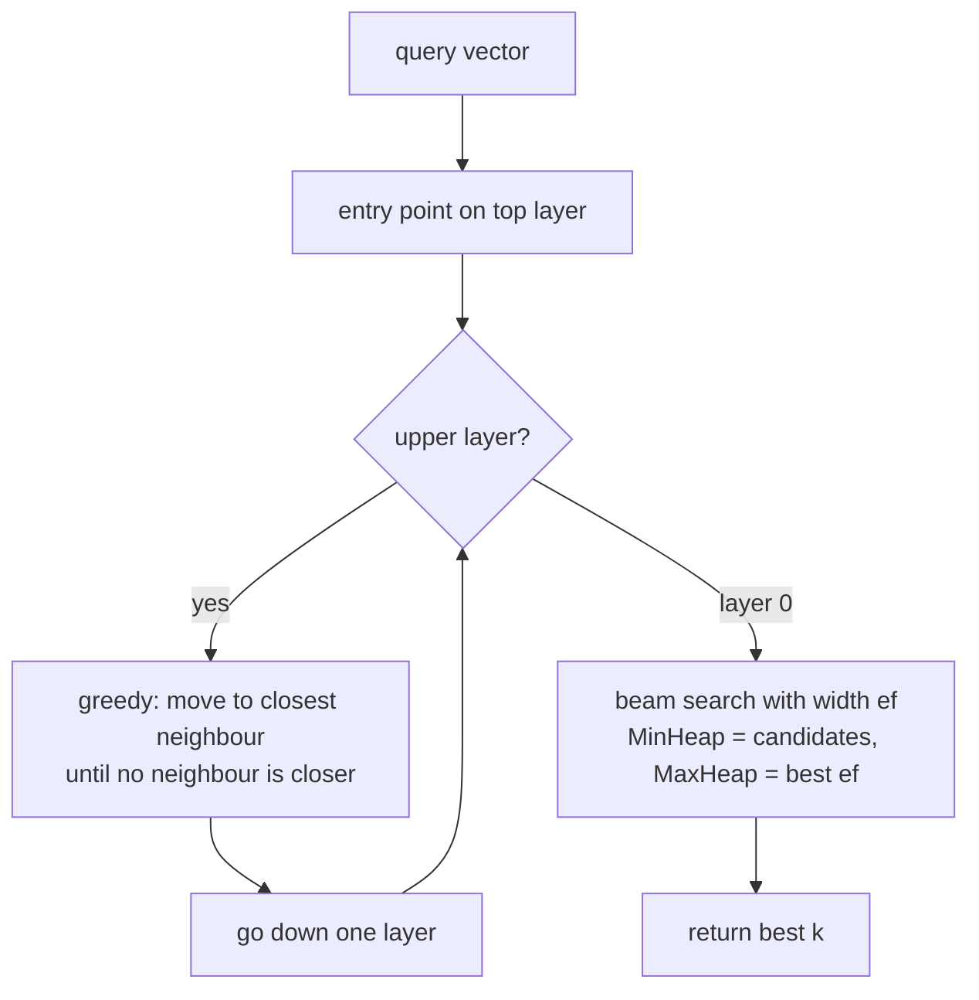
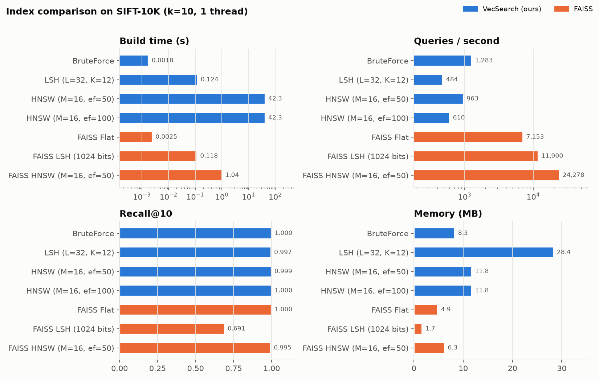
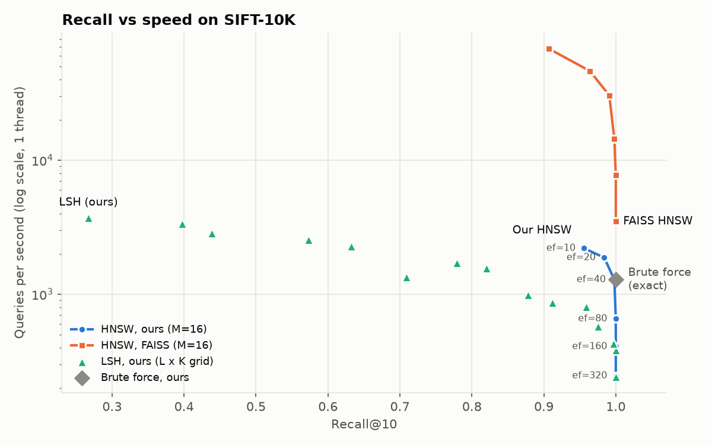
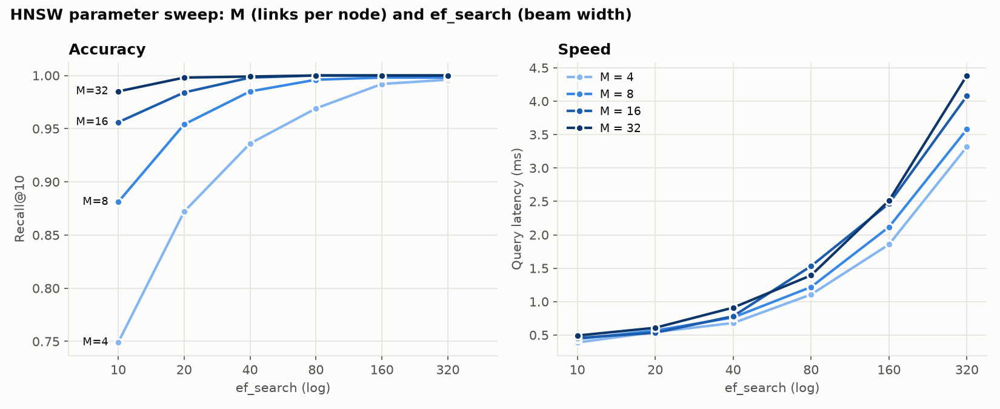
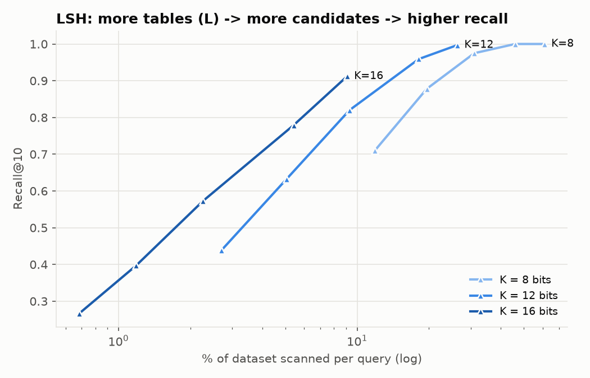
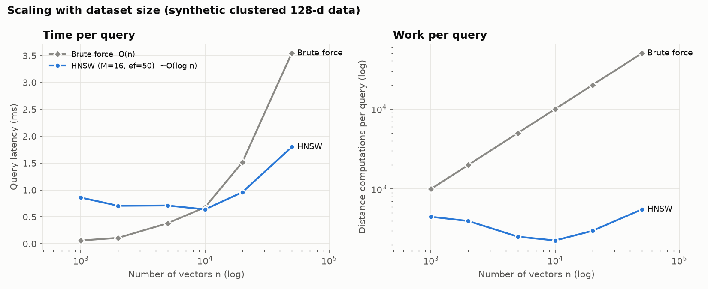
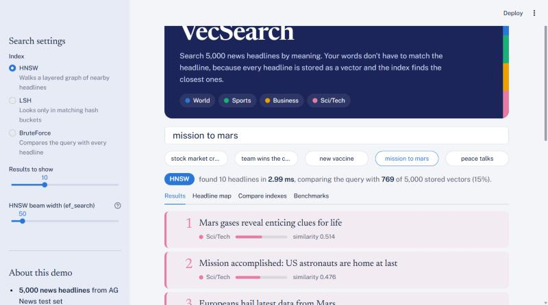
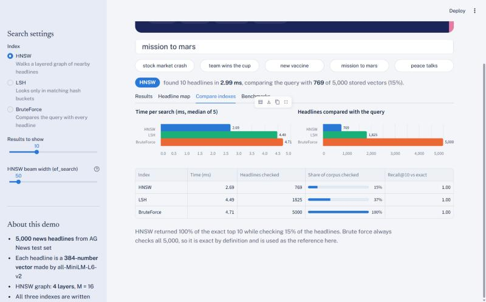

# VecSearch

A vector similarity search engine built **from scratch in Python + NumPy**: exact Brute Force,
Locality Sensitive Hashing (LSH) and Hierarchical Navigable Small World graphs (HNSW).
Benchmarked against Facebook's FAISS on SIFT-10K, with a Streamlit semantic search demo.

Made as my Data Structures and Algorithms course project. All the data structures the indexes
need (binary heaps, a dynamic array, hash buckets, a layered graph) are written by hand.
FAISS is only used in the benchmarks, as the reference to compare against.

**Highlights (SIFT-10K, 10,000 x 128-d vectors, 100 queries, k = 10, one CPU thread):**

* **HNSW Recall@10 = 0.999 at ef_search = 50 and 1.000 at ef_search = 100**, computing only
  ~650 distances per query instead of 10,000 (FAISS HNSW with the same settings: 0.995).
* **LSH Recall@10 = 0.997** with 32 tables x 12 bits (FAISS IndexLSH with 1024 bits: 0.691).
* At 50,000 vectors our pure-Python HNSW answers queries **1.8x faster than NumPy brute force**
  (1.92 ms vs 3.47 ms) with Recall@10 = 0.998, while computing ~1% of the distances.

## Architecture



**How a query flows through HNSW**



## Project structure

```
vecsearch/
├── vecsearch/           core library (no ANN libraries used)
│   ├── distance.py      euclidean, cosine, dot product (single + vectorized batch)
│   ├── heap.py          hand-written binary MinHeap / MaxHeap + k_smallest
│   ├── base.py          abstract BaseIndex, VectorStore (dynamic array)
│   ├── brute_force.py   BruteForceIndex - exact, used as ground truth
│   ├── lsh.py           LSHIndex - random hyperplanes, multiple tables, multi-probe
│   ├── hnsw.py          HNSWIndex - multi-layer graph, heuristic neighbour selection
│   └── persistence.py   save / load indexes
├── tests/               pytest suite (94 tests)
├── benchmarks/
│   ├── datasets.py      SIFT-10K download (synthetic fallback)
│   ├── run_benchmarks.py
│   └── results/         CSVs, summary.json, charts
├── app/
│   ├── search_engine.py backend (corpus, embeddings, indexes)
│   └── streamlit_app.py UI
├── notebooks/hnsw_visualization.ipynb
└── docs/                REPORT.md, VIVA_NOTES.md, screenshots/
```

## Setup (Windows)

```powershell
cd D:\PROJECTS\vecsearch
python -m venv .venv
.\.venv\Scripts\activate
pip install -r requirements.txt
```

(Linux / macOS: `source .venv/bin/activate` instead of the activate line.)

## Usage

### As a library

```python
import numpy as np
from vecsearch import BruteForceIndex, LSHIndex, HNSWIndex

data = np.random.rand(10_000, 128).astype("float32")
query = np.random.rand(128).astype("float32")

index = HNSWIndex(dim=128, metric="l2", M=16, ef_construction=200, ef_search=50)
index.add(data)                       # ids default to 0..n-1, or pass ids=[...]
ids, distances = index.search(query, k=10)
ids, distances = index.search(query, k=10, ef=100)   # more accurate, slower

index.save("my_index")                # folder with header.json, arrays.npz, structure.pkl
same = HNSWIndex.load("my_index")
```

All indexes share the same API: `add`, `search`, `search_batch`, `save`, `load`, `len()`.
Metrics: `"l2"`, `"cosine"`, `"ip"` (inner product).

### Run the tests

```powershell
python -m pytest
```

### Run the benchmarks

```powershell
python benchmarks\run_benchmarks.py            # full run, about 6-7 minutes
python benchmarks\run_benchmarks.py --quick    # smaller sweeps
python benchmarks\run_benchmarks.py --charts-only   # redraw charts from saved CSVs
```

SIFT-10K is downloaded automatically into `data/` the first time (from the INRIA TEXMEX FTP
server). If the download fails, synthetic clustered 128-d data of the same size is used.

### Run the demo app

```powershell
streamlit run app\streamlit_app.py
```

Then open http://localhost:8501. The first start downloads the sentence model and the AG News
headlines, embeds 5,000 headlines and builds the indexes (about a minute). After that everything is
loaded from `app/cache/` in a couple of seconds.

### Open the visualization notebook

```powershell
jupyter notebook notebooks\hnsw_visualization.ipynb
```

## Results

All numbers come from `python benchmarks\run_benchmarks.py` (CSV files in
[benchmarks/results](benchmarks/results)). Every index is queried one vector at a time on a single
thread; FAISS is pinned to 1 thread too so the comparison is fair.

### Main comparison - SIFT-10K

| Index | Build (s) | Queries/s | Latency (ms) | **Recall@10** | Distances / query | Memory (MB) |
|---|---:|---:|---:|---:|---:|---:|
| BruteForce (ours) | 0.002 | 1,283 | 0.78 | **1.000** | 10,000 | 8.3 |
| LSH, L=32 K=12 (ours) | 0.12 | 484 | 2.07 | **0.997** | 2,629 | 28.4 |
| HNSW, M=16 ef=50 (ours) | 42.3 | 963 | 1.04 | **0.999** | 652 | 11.8 |
| HNSW, M=16 ef=100 (ours) | 42.3 | 610 | 1.64 | **1.000** | 997 | 11.8 |
| FAISS Flat | 0.002 | 7,153 | 0.14 | 1.000 | 10,000 | 4.9 |
| FAISS LSH (1024 bits) | 0.12 | 11,900 | 0.08 | 0.691 | - | 1.7 |
| FAISS HNSW, M=16 ef=50 | 1.04 | 24,278 | 0.04 | 0.995 | 582 | 6.3 |



**What this shows**

* **Accuracy:** our HNSW matches FAISS HNSW (0.999 vs 0.995 at the same M and ef) and does a
  similar amount of work (652 vs 582 distances per query), so the graph is built correctly.
  Our LSH is much more accurate than FAISS's binary LSH because we re-rank the candidates with
  the exact distance.
* **Speed:** FAISS is 25x faster because it is C++ with SIMD; our search loop runs in the Python
  interpreter. At 10K vectors brute force is still the fastest of our indexes because it is one
  BLAS call - HNSW only pulls ahead when n gets bigger (see scaling).
* **Memory:** our numbers include Python object overhead (lists of ints for the graph and buckets),
  which is why they are larger than FAISS's packed arrays.

### Recall vs speed trade-off



### HNSW parameters (M and ef_search)

| M | ef=10 | ef=20 | ef=40 | ef=80 | ef=160 |
|---|---:|---:|---:|---:|---:|
| 4 | 0.749 | 0.872 | 0.936 | 0.969 | 0.992 |
| 8 | 0.881 | 0.954 | 0.985 | 0.996 | 0.998 |
| 16 | 0.956 | 0.984 | 0.998 | **1.000** | 1.000 |
| 32 | 0.985 | 0.998 | 0.999 | **1.000** | 1.000 |

*Recall@10 on SIFT-10K (ef_construction = 100).* Bigger M gives a better connected graph and higher
recall at small ef, at the cost of slower builds (23 s for M=4 vs 50 s for M=32) and more memory.



### LSH parameters (tables L and bits K)

More tables -> more candidates -> higher recall. With K = 12 bits: L=4 gives recall 0.632 scanning 5%
of the data, L=16 gives 0.959 scanning 18%, L=32 gives 0.997 scanning 26%.



### Scaling with dataset size (synthetic 128-d, up to 50K)

| n | Brute force (ms) | HNSW (ms) | HNSW Recall@10 | HNSW distances / query |
|---:|---:|---:|---:|---:|
| 1,000 | 0.06 | 0.67 | 1.000 | 448 |
| 5,000 | 0.30 | 0.51 | 1.000 | 252 |
| 10,000 | 0.94 | 0.65 | 1.000 | 226 |
| 20,000 | 1.45 | 0.87 | 1.000 | 299 |
| 50,000 | 3.47 | 1.92 | 0.998 | 555 |

Brute force grows linearly; HNSW work stays in the hundreds of distance computations. The crossover
where our Python HNSW beats NumPy brute force is around 10K vectors.



## Screenshots

**Semantic search with HNSW** (query: "mission to mars"). Each result is coloured by its news category.



**Headline map**: all 5,000 headline vectors projected to 2-D, with the query and its nearest neighbours


**Comparing the three indexes on the same query**: time, headlines checked and recall vs exact search



## Documentation

* [docs/REPORT.md](docs/REPORT.md) - full project report (algorithms, complexity analysis, results)
* [docs/VIVA_NOTES.md](docs/VIVA_NOTES.md) - questions and answers on every concept used
* [PROGRESS.md](PROGRESS.md) - stage by stage development log

## References

* Malkov & Yashunin, *Efficient and robust approximate nearest neighbor search using Hierarchical
  Navigable Small World graphs*, 2016 (arXiv:1603.09320)
* Charikar, *Similarity estimation techniques from rounding algorithms*, STOC 2002
* Lv et al., *Multi-probe LSH*, VLDB 2007
* Jegou, Douze & Schmid, *Product quantization for nearest neighbor search*, TPAMI 2011 (SIFT dataset)
* FAISS: https://github.com/facebookresearch/faiss
