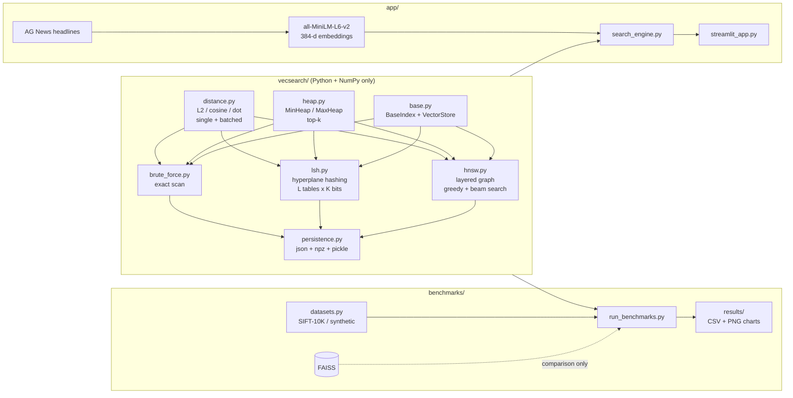
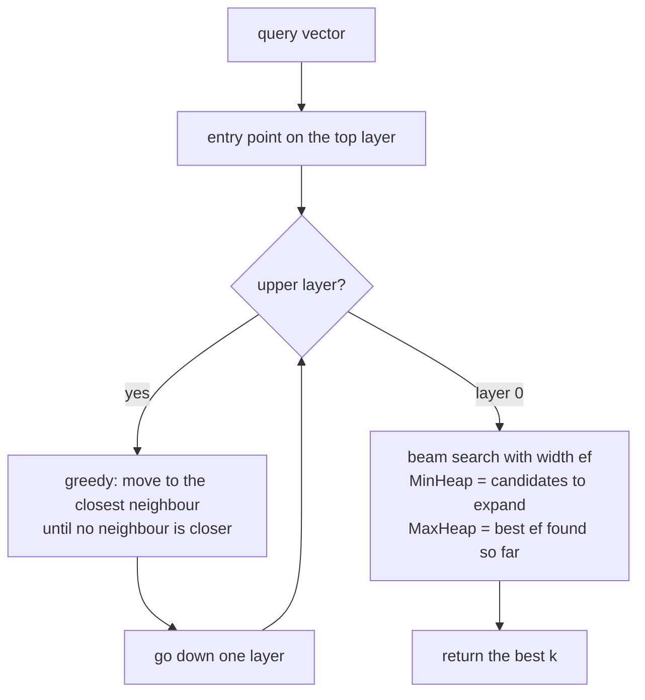

<div align="center">

# VecSearch

**A vector similarity search engine built from scratch in Python + NumPy:
Brute Force, Locality Sensitive Hashing and HNSW graphs, benchmarked against FAISS.**

[](https://vecsearch-ankit.streamlit.app/)


**[Live demo](https://vecsearch-ankit.streamlit.app/)** ·
**[Project report](docs/REPORT.md)** ·
**[Viva notes](docs/VIVA_NOTES.md)** ·
**[Benchmarks](#results)**

</div>

---

## What is this?

Modern search, recommendation and RAG systems turn text, images and audio into **vectors** and then
need to find the vectors **closest** to a query, fast. VecSearch implements the three classic answers
to that problem from first principles:

| Index | Idea | Exact? |
|---|---|---|
| **Brute Force** | Compare the query with every vector | Yes |
| **LSH** | Random hyperplanes hash similar vectors into the same bucket; only those buckets are checked | No |
| **HNSW** | A multi-layer "small world" graph; walk from a sparse top layer down to the dense bottom layer | No |

Every data structure these indexes need is written by hand: **binary min/max heaps**, a **dynamic
array**, **hash-table buckets** and a **layered adjacency-list graph**. No `heapq`, no FAISS, no
hnswlib in the core library. FAISS is used only in the benchmarks, as the reference to beat.

This is my Data Structures and Algorithms course project.

## Try it live

**[vecsearch-ankit.streamlit.app](https://vecsearch-ankit.streamlit.app/)** - type any topic and the app
searches **5,000 real news headlines by meaning** using my HNSW index.

> The free hosting puts the app to sleep when nobody has used it for a while. If you see a
> "wake up" button, click it and give it a minute to start.


| Headline map | Index comparison |
|---|---|
|  |  |

What the demo shows:

* **Results** - headlines ranked by cosine similarity, colour coded by news category
* **Headline map** - all 5,000 headline vectors projected to 2-D, with your query and its neighbours
* **Compare indexes** - the same query through HNSW, LSH and Brute Force: time, vectors checked, recall
* **Benchmarks** - the SIFT-10K results below

## Highlights

* **HNSW Recall@10 = 0.999** at `ef_search = 50` and **1.000** at `ef_search = 100` on SIFT-10K,
  computing only **~650 distances per query instead of 10,000**. FAISS HNSW with the same settings: 0.995.
* **LSH Recall@10 = 0.997** with 32 tables x 12 bits. FAISS `IndexLSH` (1024 bits): 0.691.
* At **50,000 vectors** my pure-Python HNSW is **1.8x faster than NumPy brute force** (1.92 ms vs 3.47 ms)
  at Recall@10 = 0.998, while checking about 1% of the vectors.
* Indexes **save and load** from disk; a loaded HNSW index can keep growing and produces exactly the
  same graph as an uninterrupted build.

## Contents

- [How it works](#how-it-works)
- [Complexity](#complexity)
- [Results](#results)
- [Project structure](#project-structure)
- [Quick start](#quick-start)
- [Using the library](#using-the-library)
- [Tests](#tests)
- [Deployment](#deployment)
- [Future work](#future-work)
- [References](#references)
- [Copyright](#copyright)

## How it works



### HNSW search, step by step



* **Levels** are random: `level = floor(-ln(U) / ln(M))`, so each layer holds about `1/M` of the nodes of
  the layer below, like a skip list. That gives `O(log n)` layers.
* **Neighbours** are chosen with the heuristic from the HNSW paper: a candidate is kept only if it is closer
  to the new node than to any neighbour already kept. This keeps "bridge" edges between clusters.
* **LSH** packs `K` hyperplane signs into one integer bucket key per table, probes the buckets one bit away
  (multi-probe), and re-ranks the candidates with the exact distance.

The [visualization notebook](notebooks/hnsw_visualization.ipynb) draws every HNSW layer and the path a real
query takes through them.

## Complexity

| Index | Build | Query | Memory |
|---|---|---|---|
| Brute Force | `O(n d)` | `O(n d)` | `O(n d)` |
| LSH (L tables, K bits) | `O(n L K d)` | `O(L K d + C d + C log k)`, C = candidates | `O(n d + n L)` |
| HNSW | `O(n log n * ef_c * M * d)` | `~O(log n * M d + ef * M d)` | `O(n d + n M)` |
| Binary heap | heapify `O(n)` | push / pop `O(log n)`, peek `O(1)` | `O(n)` |

Every class and method in `vecsearch/` documents its own time and space complexity in its docstring.

## Results

All numbers come from `python benchmarks/run_benchmarks.py` (raw CSVs in
[benchmarks/results](benchmarks/results)). Every index is queried **one vector at a time on one CPU
thread**, and FAISS is pinned to one thread too, so the comparison is fair.

### Main comparison: SIFT-10K (10,000 x 128-d, 100 queries, k = 10)

| Index | Build (s) | Queries/s | Latency (ms) | **Recall@10** | Distances / query | Memory (MB) |
|---|---:|---:|---:|---:|---:|---:|
| BruteForce (mine) | 0.002 | 1,283 | 0.78 | **1.000** | 10,000 | 8.3 |
| LSH, L=32 K=12 (mine) | 0.12 | 484 | 2.07 | **0.997** | 2,629 | 28.4 |
| HNSW, M=16 ef=50 (mine) | 42.3 | 963 | 1.04 | **0.999** | 652 | 11.8 |
| HNSW, M=16 ef=100 (mine) | 42.3 | 610 | 1.64 | **1.000** | 997 | 11.8 |
| FAISS Flat | 0.002 | 7,153 | 0.14 | 1.000 | 10,000 | 4.9 |
| FAISS LSH (1024 bits) | 0.12 | 11,900 | 0.08 | 0.691 | - | 1.7 |
| FAISS HNSW, M=16 ef=50 | 1.04 | 24,278 | 0.04 | 0.995 | 582 | 6.3 |


**Reading the table**

* **Accuracy:** my HNSW matches FAISS HNSW (0.999 vs 0.995 at the same M and ef) with a similar amount of work
  (652 vs 582 distances per query), which confirms the graph is built correctly.
* **Speed:** FAISS is about 25x faster because it is C++ with SIMD, while my search loop runs in the Python
  interpreter. At 10K vectors NumPy brute force is still my fastest index because it is a single BLAS call;
  HNSW pulls ahead as `n` grows (see scaling below).
* **Memory:** my numbers include Python object overhead (lists of ints for the graph and buckets), so they are
  larger than FAISS's packed C arrays.

### Recall vs speed


### HNSW parameters

| M | ef=10 | ef=20 | ef=40 | ef=80 | ef=160 |
|---|---:|---:|---:|---:|---:|
| 4 | 0.749 | 0.872 | 0.936 | 0.969 | 0.992 |
| 8 | 0.881 | 0.954 | 0.985 | 0.996 | 0.998 |
| 16 | 0.956 | 0.984 | 0.998 | **1.000** | 1.000 |
| 32 | 0.985 | 0.998 | 0.999 | **1.000** | 1.000 |

*Recall@10 on SIFT-10K, ef_construction = 100.* Larger M connects the graph better and gives higher recall at
small ef, at the cost of slower builds (23 s for M=4, 50 s for M=32) and more memory.


### LSH parameters

More tables means more candidates and higher recall. With K = 12 bits: L=4 gives 0.632 recall while scanning
5% of the data, L=16 gives 0.959 at 18%, L=32 gives 0.997 at 26%.


### Scaling with dataset size (synthetic 128-d, up to 50K)

| n | Brute force (ms) | HNSW (ms) | HNSW Recall@10 | HNSW distances / query |
|---:|---:|---:|---:|---:|
| 1,000 | 0.06 | 0.67 | 1.000 | 448 |
| 5,000 | 0.30 | 0.51 | 1.000 | 252 |
| 10,000 | 0.94 | 0.65 | 1.000 | 226 |
| 20,000 | 1.45 | 0.87 | 1.000 | 299 |
| 50,000 | 3.47 | 1.92 | 0.998 | 555 |

Brute force grows linearly with `n`; HNSW work stays in the hundreds of distance computations. My Python HNSW
overtakes NumPy brute force at around 10K vectors.


## Project structure

```
vecsearch/
├── vecsearch/              core library (Python + NumPy only)
│   ├── distance.py         euclidean, cosine, dot product (single + vectorized batch)
│   ├── heap.py             hand-written binary MinHeap / MaxHeap + k_smallest
│   ├── base.py             abstract BaseIndex, VectorStore (dynamic array)
│   ├── brute_force.py      BruteForceIndex: exact, used as ground truth
│   ├── lsh.py              LSHIndex: random hyperplanes, multiple tables, multi-probe
│   ├── hnsw.py             HNSWIndex: layered graph, heuristic neighbour selection
│   └── persistence.py      save / load indexes
├── tests/                  pytest suite (94 tests)
├── benchmarks/
│   ├── datasets.py         SIFT-10K download (synthetic fallback)
│   ├── run_benchmarks.py   all experiments, CSVs and charts
│   └── results/
├── app/
│   ├── search_engine.py    demo backend: corpus, embeddings, indexes
│   ├── streamlit_app.py    demo UI
│   └── requirements.txt    lighter requirements used by the deployed app
├── notebooks/hnsw_visualization.ipynb
├── docs/                   REPORT.md, VIVA_NOTES.md, screenshots/
├── .streamlit/config.toml  app theme
├── requirements.txt        everything (library, tests, benchmarks, app, notebook)
└── LICENSE
```

## Quick start

```powershell
git clone https://github.com/Ankit-builds1/vecsearch-hnsw-lsh.git
cd vecsearch-hnsw-lsh
python -m venv .venv
.\.venv\Scripts\activate          # Linux / macOS: source .venv/bin/activate
pip install -r requirements.txt
```

| Task | Command |
|---|---|
| Run the demo app | `streamlit run app/streamlit_app.py` |
| Run the tests | `python -m pytest` |
| Run all benchmarks (~6-7 min) | `python benchmarks/run_benchmarks.py` |
| Faster benchmark run | `python benchmarks/run_benchmarks.py --quick` |
| Redraw charts from saved CSVs | `python benchmarks/run_benchmarks.py --charts-only` |
| Open the HNSW notebook | `jupyter notebook notebooks/hnsw_visualization.ipynb` |

SIFT-10K downloads automatically into `data/` the first time (INRIA TEXMEX corpus). If the download fails,
synthetic 128-d data of the same size is used instead.

## Using the library

```python
import numpy as np
from vecsearch import BruteForceIndex, LSHIndex, HNSWIndex

data = np.random.rand(10_000, 128).astype("float32")
query = np.random.rand(128).astype("float32")

index = HNSWIndex(dim=128, metric="l2", M=16, ef_construction=200, ef_search=50)
index.add(data)                                    # ids default to 0..n-1, or pass ids=[...]
ids, distances = index.search(query, k=10)
ids, distances = index.search(query, k=10, ef=100) # wider beam: more accurate, slower

index.save("my_index")                             # folder: header.json, arrays.npz, structure.pkl
same = HNSWIndex.load("my_index")
```

All indexes share one API: `add`, `search`, `search_batch`, `save`, `load`, `len()`.
Metrics: `"l2"`, `"cosine"`, `"ip"` (inner product).

## Tests

```powershell
python -m pytest
```

94 tests cover heap ordering and heapify, distance functions against known values, empty indexes,
`k > n`, `k = 0`, wrong dimensions and NaN input, LSH and HNSW recall against brute force, HNSW graph
invariants (degree limits, nested layers, no self loops, level distribution), save/load round trips, and an
end-to-end Recall@10 >= 0.90 check on SIFT-10K.

## Deployment

The demo runs on **Streamlit Community Cloud** straight from this repository:

* Main file: `app/streamlit_app.py`, Python 3.12
* `app/requirements.txt` installs only what the app needs, with **CPU-only PyTorch** (the default Linux build
  would pull about 2.5 GB of GPU libraries)
* On first start the app downloads the AG News headlines and the MiniLM model, embeds 5,000 headlines and
  builds the indexes (about a minute), then caches them with the project's own save/load code

## Future work

* Move the hot loops (beam search, neighbour heuristic) to Cython, Numba or C++
* Deletions, product quantization (PQ) and an IVF index for comparison
* Batched and multithreaded queries
* Filtered search (for example, only Sports headlines) and hybrid keyword + vector search
* Experiments on SIFT-1M and GIST-1M

## References

1. Y. A. Malkov, D. A. Yashunin. *Efficient and robust approximate nearest neighbor search using Hierarchical
   Navigable Small World graphs.* IEEE TPAMI, 2018 ([arXiv:1603.09320](https://arxiv.org/abs/1603.09320))
2. M. S. Charikar. *Similarity estimation techniques from rounding algorithms.* STOC, 2002
3. Q. Lv et al. *Multi-probe LSH: efficient indexing for high-dimensional similarity search.* VLDB, 2007
4. H. Jegou, M. Douze, C. Schmid. *Product quantization for nearest neighbor search.* IEEE TPAMI, 2011 (SIFT dataset)
5. J. Johnson, M. Douze, H. Jegou. *Billion-scale similarity search with GPUs.* IEEE Trans. Big Data, 2019
   ([FAISS](https://github.com/facebookresearch/faiss))
6. N. Reimers, I. Gurevych. *Sentence-BERT.* EMNLP, 2019 (all-MiniLM-L6-v2)
7. X. Zhang, J. Zhao, Y. LeCun. *Character-level convolutional networks for text classification.* NeurIPS, 2015 (AG News)

## Copyright

Copyright © 2026 Ankit Dash. All rights reserved.

This project is my original work for my Data Structures and Algorithms course. The source code, report,
benchmarks and demo may not be copied, redistributed or submitted as someone else's work without my written
permission. See [LICENSE](LICENSE).

Third-party data and models keep their own licences: SIFT-10K (INRIA TEXMEX), AG News, all-MiniLM-L6-v2
(sentence-transformers) and FAISS (Meta, used only for benchmarking).

<div align="center">

Made by **Ankit Dash** · [GitHub](https://github.com/Ankit-builds1) · [Live demo](https://vecsearch-ankit.streamlit.app/)

</div>
